<div align="center">

# 4-DOF Robotic Arm — Robust Direct MRAC in ROS 2

**Adaptive control of a 4-DOF manipulator using Model Reference Adaptive Control (MRAC), simulated end-to-end in ROS 2 Jazzy + Gazebo Harmonic, with MoveIt 2 for trajectory planning.**


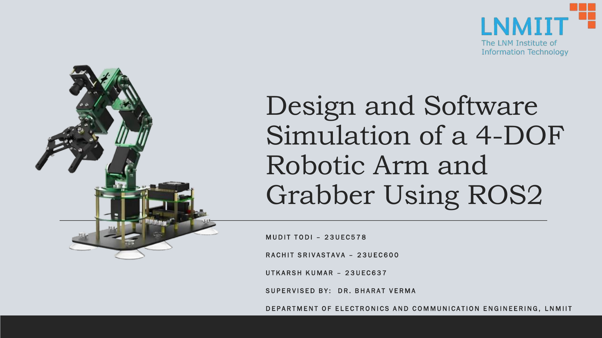

</div>

---

## Overview

Fixed-gain PID controllers degrade quickly on robotic manipulators once payload, friction, or gravitational loading change — no single set of gains handles all operating conditions. This project splits the problem into two cooperating pieces:

- **Direct MRAC** models and controls the arm itself: it adjusts feedback and feedforward gains online, in closed loop, so each joint's response tracks a chosen reference model — this is the part responsible for the arm's core tracking behavior.
- A **robust augmentation** sits on top of it, dedicated purely to uncertainties and disturbances the MRAC layer wasn't designed to handle — unmodeled friction, Coriolis coupling, and payload/gravity variation — via a small online-learned compensation term.

**MoveIt 2** handles one-shot Cartesian/joint-space path planning; the **custom MRAC controller** takes over closed-loop tracking of that plan at **1 kHz**, adapting its gains as it goes. This was built as a Bachelor's Thesis Project (BTP) at LNMIIT, ECE Department.

---

## Demo

<!--
  1st-loop / 4th-loop training clips, as autoplaying GIFs so they run the
  moment the repo page loads (regular embedded video needs a click — GIFs
  don't). Drop the .gif files in docs/assets/ and reference them below.
-->

| 1st Training Loop | 4th Training Loop |
|:---:|:---:|
| 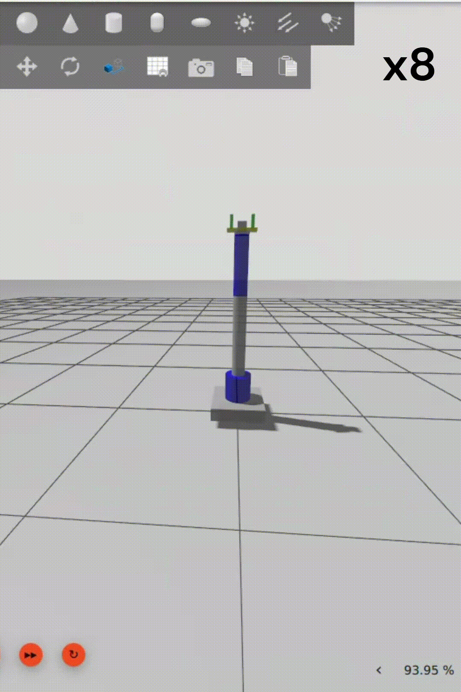 | 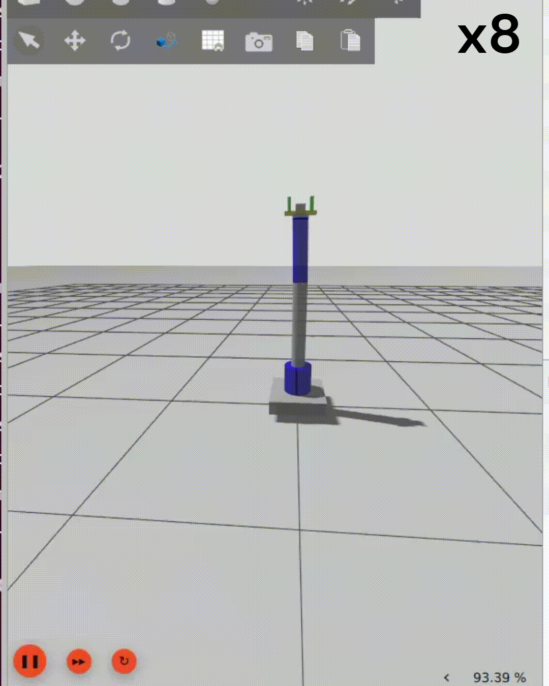 |

---

## Why MRAC?

### Direct MRAC — modeling and tracking the arm

This is the layer that **models and controls the arm itself**. Rather than deriving and inverting the full nonlinear dynamics of the manipulator, Direct MRAC drives each joint toward a **reference model** `G_ref(s) = ω_n² / (s² + 2ζω_n·s + ω_n²)` representing the desired second-order response, and adapts feedback gain `K_x` and feedforward gain `K_r` online until the real joint's behavior matches it:

```
u = K̂_x · q + K̂_r · r
K̇_x = −Γ_x ∫ e·sign(b)·x dt
K̇_r = −Γ_r ∫ e·sign(b)·r dt
```

Adaptation is derived from a Lyapunov stability argument and convergence is established via **Barbalat's Lemma** — the same theoretical basis covered in Direct MRAC and Robust MRAC of standard adaptive-control references (see [References](#references)).

### Robust augmentation — handling uncertainty and disturbances

The Direct MRAC layer above assumes it's controlling a known nominal system. In reality the arm also experiences **friction, payload changes, and unmodeled coupling** that the reference-model tracking alone won't correct for. The robust term exists purely to handle that: it augments the baseline MRAC torque with a separate, online-learned compensation term dedicated to disturbances and uncertainty:

```
τ = u_mrac ± Ŵᵀ·α(x)
Ŵ̇ = Γ ∫ eᵀ·P·B·α(x(t)) dt
```

`α(x)` is a 6-term basis vector combining `sin(q)`, `cos(q)` (gravity/geometric nonlinearities), `tanh(q̇)` (smooth Coulomb-friction approximation), and cross-product terms (Coriolis/coupling interactions) — giving the controller a structured way to learn disturbances it was never explicitly modeled for, while the MRAC layer above keeps handling the arm's core tracking behavior.

### Our implemented controller

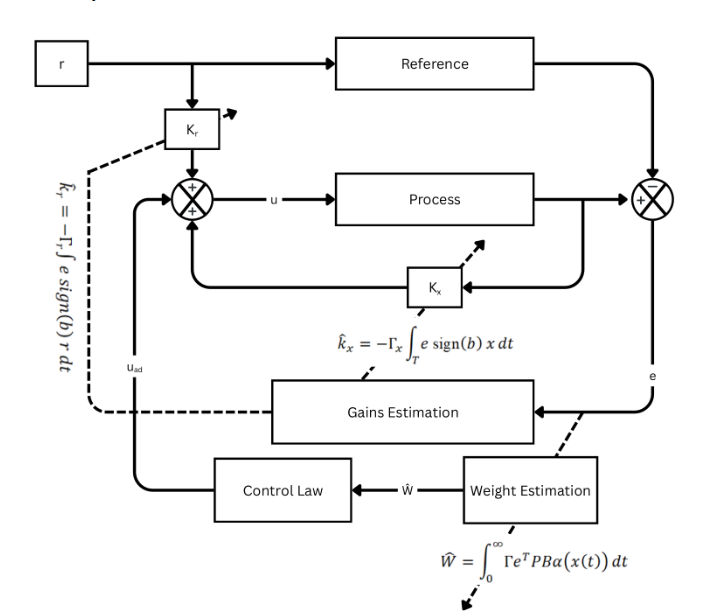

This is the actual block diagram of what's running on the arm: the reference model and gain-adaptation loop (Direct MRAC, driving `K_x`/`K_r`) combined with the weight-estimation loop (`Ŵ`) feeding a disturbance-compensation term `u_ad` into the control law.

---

## System architecture

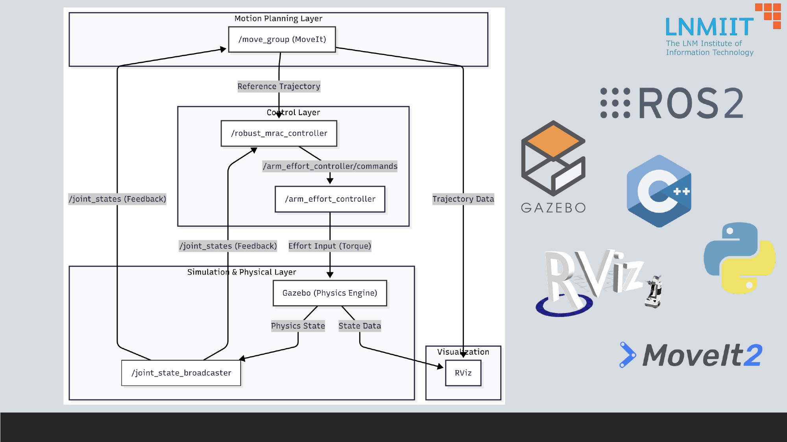

| Layer | Responsibility |
|---|---|
| **Motion Planning** (`/move_group`) | MoveIt 2 / OMPL — one-shot trajectory planning, KDL kinematics |
| **Control** (`/robust_mrac_controller`) | Custom C++ node, 1 kHz — Direct MRAC + robust adaptive law |
| **Simulation** (Gazebo) | Physics engine, joint state feedback |
| **Visualization** (RViz) | Live robot state and planning scene |

**ROS graph** (`rqt_graph`) showing the full node/topic wiring:

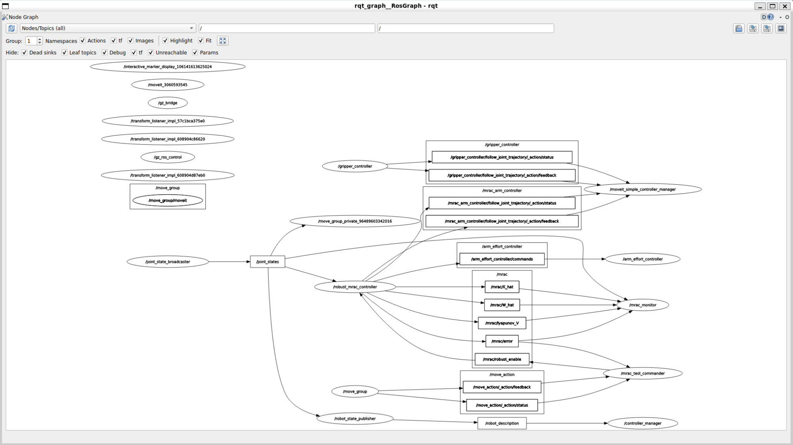

### Hardware model

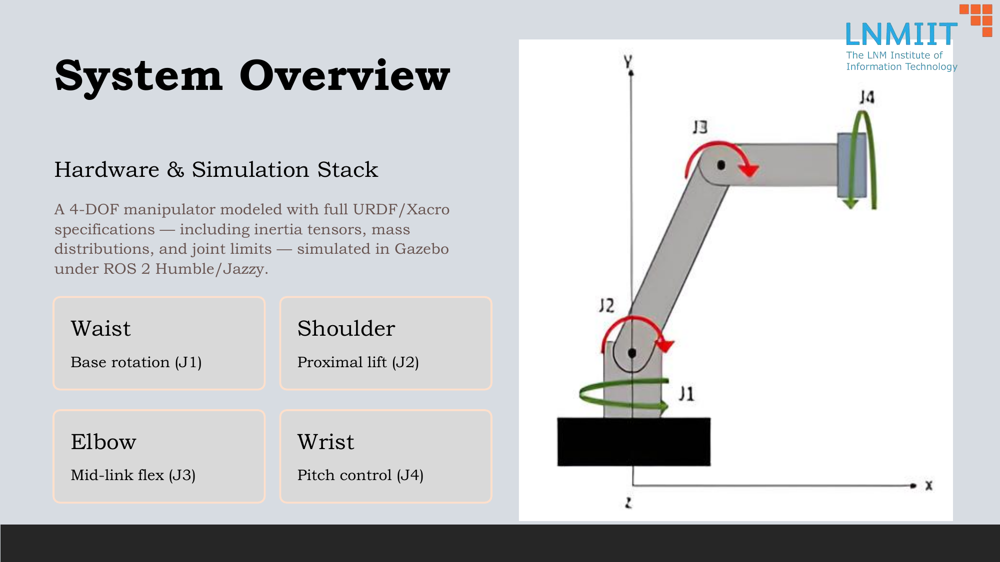

| Joint | Function |
|---|---|
| J1 — Waist | Base rotation |
| J2 — Shoulder | Proximal lift |
| J3 — Elbow | Mid-link flex |
| J4 — Wrist | Pitch control |

Full URDF/Xacro specification — inertia tensors, mass distribution, joint limits — simulated under ROS 2 Jazzy + Gazebo Harmonic.

---

## Results

The arm was driven through repeated Home → Pose 1 → Pose 2 loops (four training loops, ~170 s per loop, ~65 s average per pose switch including a 10 s hold) while the controller adapted online.

**Tracking error, reference model vs. plant:**

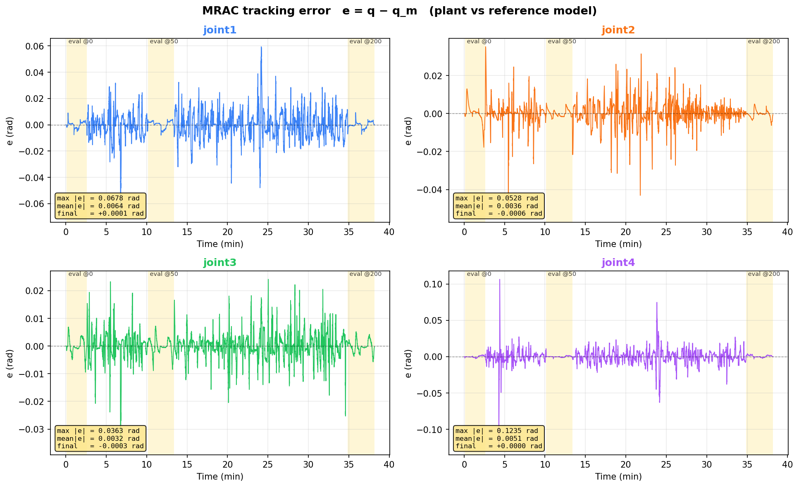

| Metric | Joint 1 | Joint 2 | Joint 3 | Joint 4 |
|---|---|---|---|---|
| Max \|e\| (rad) | 0.0322 | 0.1994 | 0.1544 | 0.0245 |
| Mean \|e\| (rad) | 0.0075 | 0.0342 | 0.0158 | 0.0049 |
| Final e (rad) | 0.0100 | 0.0339 | 0.0055 | 0.0151 |

Error decreases over time as the controller adapts. Joints 1 and 4 (wrist rotations) don't work against gravity, so their tracking error is negligible by comparison; joint 2 (shoulder) carries the most gravitational disturbance and shows correspondingly larger, but still bounded and converging, error.

**Adaptive gain convergence (`K_x`, `K_r`, `‖Ŵ‖`):**

<p float="left">
  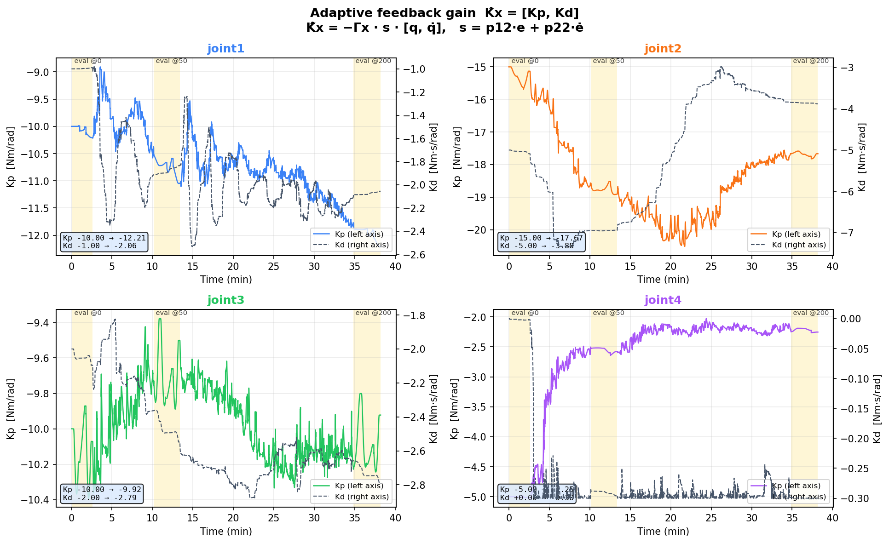
  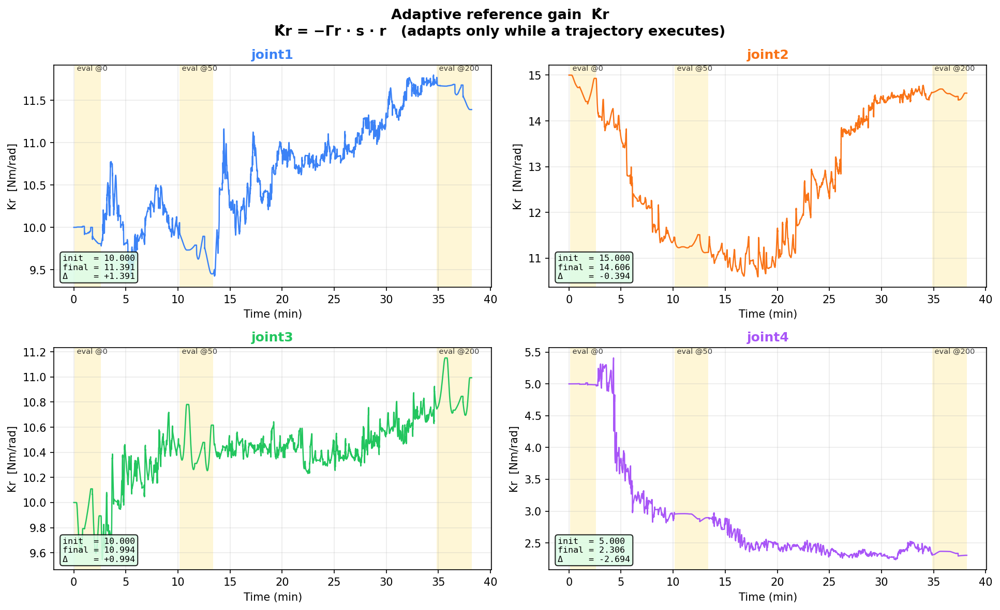
</p>
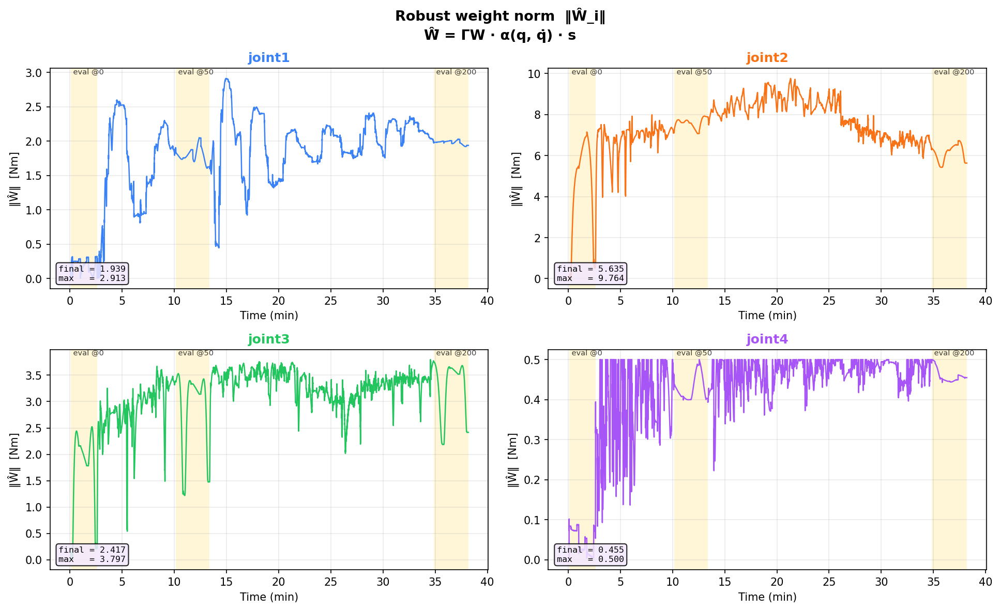

Gains settle into a narrow band rather than drifting — the larger oscillations on joints 2 and 3 reflect exactly the uncertainty (gravity/payload loading) the robust term exists to absorb.

**Lyapunov energy:**

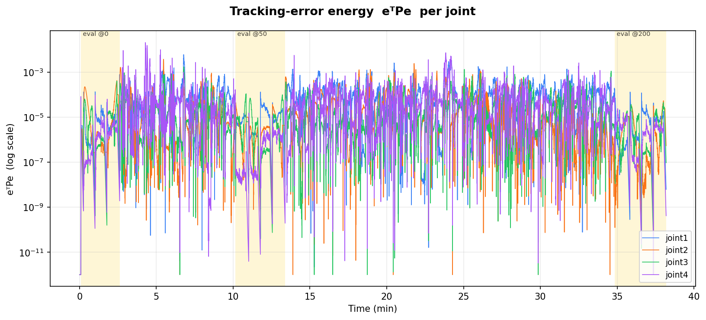

Joint 2's Lyapunov value settles at a visibly higher level than the other joints, consistent with it carrying the largest disturbance from gravitational loading on the base joint.

---

## Repository structure

```
.
├── mrac_controller/            # Core C++ MRAC controller (1 kHz control loop)
│   ├── src/mrac_controller.cpp
│   ├── src/robust_direct_mrac_params.yaml
│   └── MRAC_TUNING_GUIDE.md
│
├── my_robot_description/       # URDF/Xacro robot model
│   ├── urdf/                   # arm, gripper, ros2_control, common properties
│   ├── launch/display.launch.xml   # RViz-only viewer (no Gazebo)
│   └── DAMPING_FRICTION_GUIDE.md
│
├── my_robot_moveit_config/      # MoveIt 2 configuration
│   ├── config/                 # SRDF, kinematics, joint limits, controllers
│   └── launch/                 # move_group, moveit_rviz, spawn_controllers, ...
│
├── my_robot_bringup/            # Full-system launch
│   ├── launch/my_robot_gz.launch.py   # canonical entry point
│   ├── config/ros2_controllers.yaml
│   └── scripts/                # check_mrac_system.py, debug_system.py
│
├── my_robot_commander_py/       # Python training loop + live monitor
│   └── my_robot_commander_py/
│       ├── test_moveit.py       # main training loop (drives Home/Pose1/Pose2)
│       ├── mrac_monitor.py      # real-time matplotlib plots of V, e, K̂
│       ├── mrac_system_test.py / mrac_integration_test.py
│       └── diagnose_mrac.py
│
├── scripts/mrac_tuning_workflow.sh   # step-by-step tuning quick-reference
└── docs/                        # images (and videos) used in this README
```

---

## Quick start

```bash
# 1. Build
cd <your_ros2_ws>
colcon build --symlink-install

# 2. Launch the full stack (Gazebo + MoveIt + MRAC controller + RViz)
source install/setup.bash
ros2 launch my_robot_bringup my_robot_gz.launch.py

# 3. In another terminal — run the training loop (drives Home → Pose1 → Pose2)
ros2 run my_robot_commander_py test_moveit

# 4. In another terminal — watch live Lyapunov energy, tracking error, adaptive gains
ros2 run my_robot_commander_py mrac_monitor
# press 'p' inside the monitor to save plots to /tmp/mrac_error_analysis.png
```

### Diagnostics

| Task | Command |
|---|---|
| RViz only, no Gazebo | `ros2 launch my_robot_description display.launch.xml` |
| RViz + MoveIt only | `ros2 launch my_robot_moveit_config moveit_rviz.launch.py` |
| Full system health check | `ros2 run my_robot_bringup check_mrac_system.py` (or `scripts/check_mrac_system.py`) |
| Live topic inspection | `ros2 topic echo /mrac/error`, `ros2 topic echo /mrac/lyapunov_V` |

For a full tuning walkthrough (build → launch → monitor → test → tune → repeat, including payload testing and rosbag recording), see [`scripts/mrac_tuning_workflow.sh`](scripts/mrac_tuning_workflow.sh) — run it with `bash scripts/mrac_tuning_workflow.sh` for a printed step-by-step guide, or open it to read directly.

### Key topics

| Topic | Publishes |
|---|---|
| `/mrac/lyapunov_V` | Lyapunov energy, per joint |
| `/mrac/K_hat` | Adaptive feedback gain `K_x` |
| `/mrac/W_hat` | Robust weight vector norm `‖Ŵ‖` |
| `/mrac/error` | Tracking error `e` |

---

## Future work

- Move from simulation to hardware: implement the same trajectory-following pipeline on physical actuators via `ros2_control` + MoveIt.
- (Optional) Pick-and-place with varying payloads, to further stress-test the robust adaptive term.

---

## References

1. K. J. Åström and B. Wittenmark, *Adaptive Control*, 2nd ed., Addison-Wesley, 1995.
2. M. W. Spong, S. Hutchinson, M. Vidyasagar, *Robot Modeling and Control*, Wiley, 2006.
3. J. J. Craig, *Introduction to Robotics: Mechanics and Control*, 3rd ed., Pearson, 2005.
4. H. K. Khalil, *Nonlinear Systems*, 3rd ed., Prentice Hall, 2002.
5. I. D. Landau, R. Lozano, M. M'Saad, A. Karimi, *Adaptive Control: Algorithms, Analysis and Applications*, 2nd ed., Springer, 2011.
6. P. A. Ioannou and J. Sun, *Robust Adaptive Control*, Prentice Hall, 1996.
7. B. Siciliano, L. Sciavicco, L. Villani, G. Oriolo, *Robotics: Modelling, Planning and Control*, Springer, 2009.
8. J.-J. E. Slotine and W. Li, *Applied Nonlinear Control*, Prentice Hall, 1991.
9. K. S. Narendra and A. M. Annaswamy, *Stable Adaptive Systems*, Prentice Hall, 1989.
10. G. Tao, *Adaptive Control Design and Analysis*, Wiley, 2003.
11. [ROS 2 Documentation](https://docs.ros.org)
12. [Gazebo Simulator Documentation](https://gazebosim.org)
13. [MoveIt Motion Planning Framework](https://moveit.ros.org)

---

## Authors

- **Mudit Todi**

## License

This project is licensed under the [MIT License](LICENSE).
